<!--
## Hi there 👋
## I'm Avrit!

### 👾 I've worked on...

- [x] **FeynTerm** – A CLI learning aid utilizing the Feynman Learning Technique to improve knowledge retention. A C (not so mini) project
      
- [x] **Autoencoder**-based anomaly detection for smart-grid faults using Explainable AI
      
- [x] **Nimbus** – Bluesky nim client

### 🔭 I’m currently working on ...
- Specialization in Machine Learning
- Basics of quantum computing
- A B-Tech in Computer Science and Engineering
- Enhancing proficiency in Data Structures and Algorithms

### 🌱 [Future projects bucket list (DON'T OPEN)](https://github.com/DukeAvi/DukeAvi/blob/main/assets/Snake.png)

**DukeAvi/DukeAvi** is a ✨ _special_ ✨ repository because its `README.md` (this file) appears on your GitHub profile.

Here are some ideas to get you started:

-  I’m currently working on ...
- 👯 I’m looking to collaborate on ...
- 🤔 I’m looking for help with ...
- 💬 Ask me about ...
- 📫 How to reach me: ...
- 😄 Pronouns: ...
- ⚡ Fun fact: ...
-->
